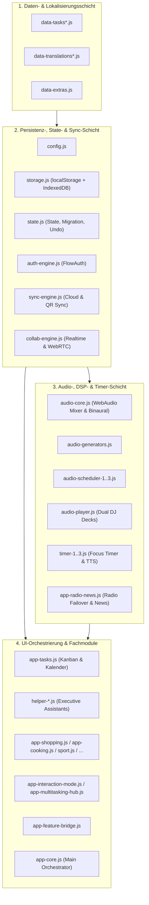

# Systemarchitektur & Technisches Handbuch – Noodle Studio

Dieses Dokument beschreibt die interne Softwarearchitektur, die Datenflüsse und die technischen Designentscheidungen von **Noodle Studio**. Es richtet sich an Entwicklerinnen, Entwickler und technische Prüfer, die sich schnell in die Codebasis einarbeiten oder diese warten und erweitern möchten.

---

## 1. Schichtenmodell & Modul-Topologie

Die Anwendung ist bewusst ohne komplexe Framework-Abhängigkeiten in modularem, standardkonformem JavaScript (ES2020+) aufgebaut. Dadurch bleibt die Codebasis langfristig wartbar, frei von Breaking Changes externer UI-Frameworks und ohne Build-Schritt direkt im Browser ausführbar.

### Warum deterministische Script-Ladereihenfolge?
In `index.html` werden die Module in aufsteigender Abhängigkeit geladen (zuerst statische Wörterbücher, dann `config.js` -> `storage.js` -> `state.js` -> `utils.js` -> Audio/Timer -> Fachmodule -> `app-core.js`).
- **Im Entwicklungsbetrieb** können Änderungen an jeder Datei sofort per Browser-Reload ohne Bundler-Wartezeit getestet werden.
- **Im Produktionsbetrieb** fügt `build.js` exakt dieselbe Liste in `dist/app.bundle.js` zusammen, wodurch Netzwerk-Roundtrips auf eine einzige Datei reduziert werden.

---

## 2. State-Management & Ausfallsichere Persistenz

### 2.1 Der Dual-Storage-Ansatz (`storage.js`)
Moderne Browser (insbesondere Safari unter iOS/macOS durch Intelligent Tracking Prevention) können reine `localStorage`-Einträge bei längerer Inaktivität oder Speicherdruck verwerfen.
`storage.js` löst dieses Problem durch eine zweistufige Speicherschicht:
1. **Synchroner Pfad (`localStorage`)**: Liest und schreibt den Zustand sofort im Hauptthread, damit UI-Interaktionen (z. B. Abhaken einer Aufgabe) ohne asynchrone Verzögerung gerendert werden.
2. **Asynchroner Spiegel (`IDB_VAULT`)**: Jede Schreiboperation spiegelt den JSON-Payload im Hintergrund in die `IndexedDB`-Datenbank `noodle_resilience_vault` (Object Store `keyval`).
3. **Selbstheilung beim Start**: Ist `localStorage` beim Start leer, prüft `storage.js` den `IDB_VAULT` und stellt den letzten bekannten Zustand transparent wieder her.

### 2.2 Schema-Migration & Speicherschutz (`state.js`)
- **`migrateState(raw, lang)`**: Garantiert, dass jeder geladene Zustand – unabhängig davon, aus welcher App-Version oder welchem JSON-Backup er stammt – alle erwarteten Arrays, Workspace-Strukturen (`private`, `work`, `study`, `shared`) und Einstellungen besitzt.
- **Stabile Element-Identitäten**: `ensureItemIdentity(item, prefix)` weist jedem Eintrag eine deterministische oder zeitstempelbasierte ID (`id`), `createdAt` und `updatedAt` zu.
- **Tombstone-Tracking (`_tombstones`)**: Wird eine Aufgabe gelöscht, speichert `trackTombstone(id)` den Löschzeitpunkt. Bei einer Cloud-Synchronisation verhindert dies, dass ein anderes Gerät mit älterem Stand die gelöschte Aufgabe wieder einfügt. Tombstones, die älter als 30 Tage sind, werden in `migrateState` automatisch bereinigt.

---

## 3. Audio-Architektur & Live-Radio-Resilienz

### 3.1 Prozedurale WebAudio-Synthese (`audio-core.js`, `audio-scheduler-*.js`)
Um die Anwendung schlank und komplett offline-fähig zu halten, werden Fokus-Klänge mathematisch zur Laufzeit erzeugt:
- **Rauschgeneratoren**: Weißes, Rosa (1/f) und Braunes ($1/f^2$) Rauschen werden einmalig als geloopte `AudioBuffer` im Arbeitsspeicher berechnet und über modulierte `BiquadFilterNode`-Ketten geformt (z. B. für Windböen, Bachplätschern oder Meeresbrandung).
- **Instrumenten-Synthese**: Klänge wie das pentatonische Piano (`audio-scheduler-1.js`) nutzen kombinierte Sinus-/Dreieck-Oszillatoren mit präzisen ADSR-Hüllkurven (`exponentialRampToValueAtTime`) und Stereo-Panning.
- **Audio-Ducking**: Sobald die Sprachausgabe (TTS) für Nachrichten oder Timer-Ansagen startet, senken `duckRadio(true)` und die Ambient-Steuerung die Musiklautstärke sanft auf 18 % des Ausgangswertes ab und blenden sie nach Ende der Sprachausgabe wieder weich ein.

### 3.2 Dreistufige Radio-Signal-Garantie (`app-radio-news.js`)
Live-Radiostreams im Web unterliegen häufig URL-Wechseln, Server-Wartungen oder CORS-/Mixed-Content-Einschränkungen. `playRadioStation(stationId)` implementiert deshalb eine dreistufige Failover-Kette:
1. **Kandidaten-Queue & Watchdog-Timer**: Jeder Sender in `RADIO_STATIONS` definiert neben dem Primärstream (`stream`) ein `streams`-Array mit geprüften HTTPS-Mirrors. Ein 4,5-Sekunden-Watchdog überwacht den Verbindungsaufbau; bei `error`-Events, abgelehnten `play()`-Promises oder Timeout wird sofort auf den nächsten Kandidaten gewechselt.
2. **Dynamische Verzeichnis-Auflösung**: Schlagen alle hinterlegten URLs fehl, fragt `resolveDynamicStreamsFromDirectory()` automatisch die offene Radio-Browser-API (`de1.api.radio-browser.info`) nach aktuell geprüften HTTPS-Streams (`lastcheckok=1`) für diesen Sender ab.
3. **Harmonischer WebAudio-Fallback (`startFallbackRadioSignal`)**: Ist das Gerät komplett offline oder blockiert eine Firewall sämtliche Audio-Streams, erzeugt die Engine über die Web Audio API einen warmen, auf den Sender abgestimmten Ambient-Akkord mit sanftem Raumrauschen. Dadurch gibt jeder Sender unter allen Netzwerkbedingungen garantiert ein angenehmes Audiosignal aus.

> **Wichtiger Hinweis zu CORS bei Icecast-Streams**: Auf dem `HTMLAudioElement` für Live-Radio darf **niemals** `audio.crossOrigin = 'anonymous'` gesetzt werden, da zahlreiche öffentlich-rechtliche und freie Icecast-Server keine `Access-Control-Allow-Origin`-Header senden und der Browser den Stream sonst blockiert.

---

## 4. Fenster-Management & UI-Ergonomie

### 4.1 Desktop Multi-Window & Snap-Layouts (`app-interaction-mode.js`, `app-multitasking-hub.js`)
- Jedes Tool-Panel und Modal wird durch einen `MutationObserver` automatisch mit einheitlichen Fenster-Steuerelementen (Minimieren `—`, Maximieren/Wiederherstellen `⛶`, Schließen `✕`) ausgestattet.
- Minimierte Fenster legen sich als kompakte Pills mit Live-Status in die untere Taskleiste.
- Über den Maximieren-Button lässt sich ein Snap-Layout-Picker öffnen, der zwei bis vier Werkzeuge gleichzeitig nebeneinander anordnet.

### 4.2 Mobile Ergonomie (`styles-mobile.css`, `app-core.js`)
- Auf Bildschirmen $\le 768\text{px}$ wechselt das Layout automatisch in eine 5-Tab-Architektur am unteren Bildschirmrand.
- Eingabefelder erzwingen `font-size: 16px`, um ungewolltes Auto-Zooming unter iOS Safari zu verhindern.

---

## 5. Sicherheits- & Datenschutzrichtlinien im Code

1. **XSS-Prävention**: Alle dynamisch in `innerHTML` eingefügten Benutzereingaben müssen durch `escapeHtml()` bzw. `escapeAttr()` aus `utils.js` maskiert werden; URLs werden über `sanitizeUrl()` gegen `javascript:`- und `data:`-Injektionen geprüft.
2. **Kein Tracking im Lokalbetrieb**: Das optionale Umami-Skript in `index.html` prüft vor dem Laden strikt den Hostnamen und schließt `file:`, `localhost`, `127.0.0.1` sowie private IP-Bereiche (`192.168.x.x`, `10.x.x.x`, `172.16-31.x.x`) vollständig aus.
3. **Konfigurations-Kapselung**: Externe API-Endpunkte sind ausschließlich in `config.js` definiert und können für Self-Hosting-Instanzen über `localStorage` (`noodle_custom_config`) oder globale Window-Variablen überschrieben werden.
